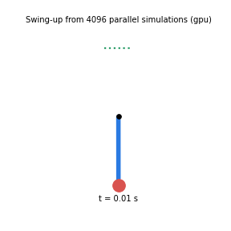
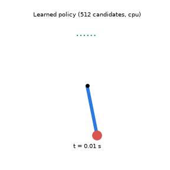
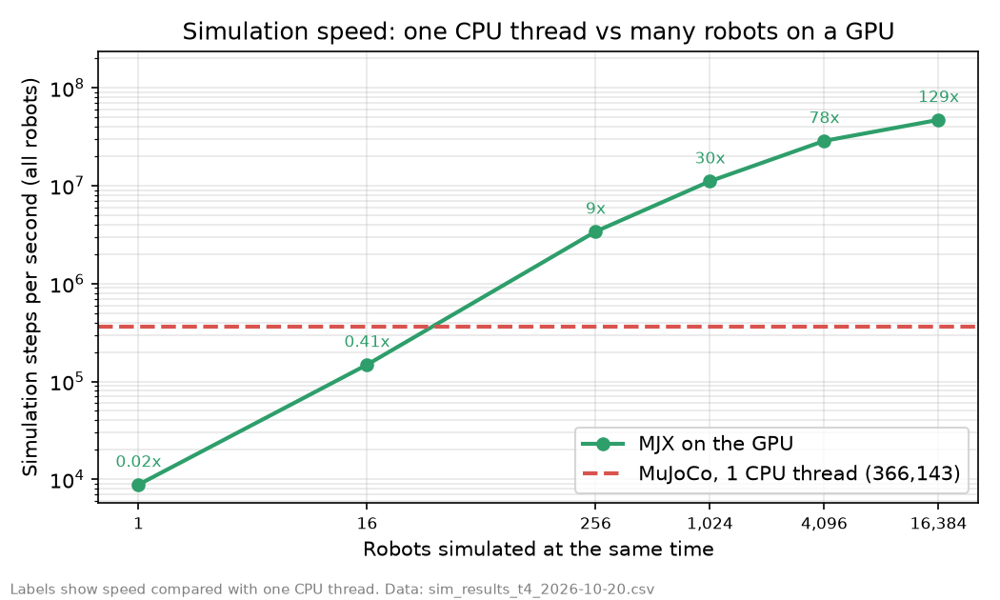
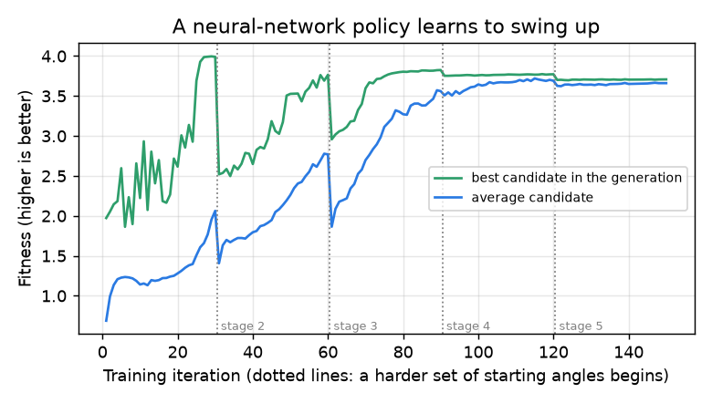
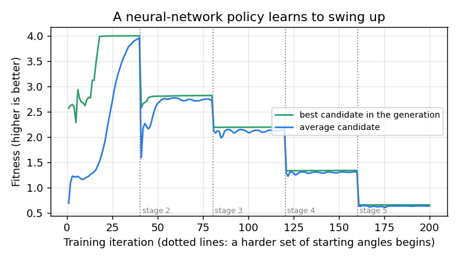

# GPU Robot Lab

[**Live explainer**](https://therealemmanueloppong.github.io/gpu-robot-lab/) | [](https://colab.research.google.com/github/therealemmanueloppong/gpu-robot-lab/blob/main/notebooks/colab_quickstart.ipynb)

[](https://colab.research.google.com/github/therealemmanueloppong/gpu-robot-lab/blob/main/notebooks/all_experiments_colab.ipynb) (run everything, one zip of results)

[](https://colab.research.google.com/github/therealemmanueloppong/gpu-robot-lab/blob/main/notebooks/robot_sim_colab.ipynb) (robot simulation)

GPU kernels written from scratch and benchmarked against PyTorch, then used to speed up a simulated robot. Built to run on a free shared GPU, so it costs nothing.

Status: complete first version, measured on a free Colab T4. The Triton matrix-multiply kernels are correct; the first version reached about 4% of `torch.matmul`, a compiler check showed it was spilling registers, and tuned versions run about **3.4 times faster** (10 to 17% of PyTorch at large sizes). Their compiled code uses no tensor cores, which is the likely cause of the remaining gap. A robot simulation runs up to **126 times faster** on the GPU than on one CPU thread (only 2.75 times once collisions are involved), and a neural-network controller learned to swing a pendulum up and hold it in 3 of 3 runs with 512 candidates per iteration, but failed with 2,048 (CPU) and 4,096 (GPU). Measurements and limits are below.

See [docs/PLAN.md](docs/PLAN.md) for the stages, the rules for what can be claimed, and the risks.

## See it

- **[Interactive explainer (live page)](https://therealemmanueloppong.github.io/gpu-robot-lab/)**: animates how the tiled kernel loads tiles and why it reads about 64 times less memory than a naive multiply, and shows the measured results. The source is `docs/index.html`.
- **Results**: below, all from real runs on a Colab T4 (matrix-multiply speed, why the first kernel was slow, which tuning helped, the tensor-core finding, and CPU versus GPU robot simulation).
- **Robot simulation (stage 2)**: a pendulum whose motor is too weak to lift it directly. Thousands of candidate motor plans are simulated at once (MuJoCo MJX), the best are kept, and the swing-up is replayed in a separate CPU simulator as a check. Planned on a Colab T4 from 4,096 parallel simulations and replayed in a separate simulator:

  

- **A learned controller**: a small neural network that reads the pole's angle and speed and outputs the motor command, trained by evolution strategies on parallel simulations and replayed in plain MuJoCo. CPU preview (from a start near the bottom):

  

- **v2 kernel**: autotuning plus grouped launch order. `scripts/check_kernels.py` and `scripts/bench_matmul.py` now check and time v1, v2 and `torch.matmul` together, so one Colab run produces the comparison.
- **Tuning study and diagnosis**: `scripts/tune_matmul.py` sweeps tile sizes, warps and pipeline stages, and `scripts/inspect_kernel.py` prints register use and spills. Results below.

## What is in the repo

- `src/gpu_robot_lab/kernels/` a tiled matrix multiply (`matmul.py`, v1), an autotuned v2 with a cache-friendly launch order (`matmul_v2.py`), and a row-wise softmax, all in Triton
- `src/gpu_robot_lab/tiling.py` a CPU model of the kernel's tiling, edge handling and launch order, tested in CI, with the memory-traffic formula
- `src/gpu_robot_lab/bench.py` timing that works correctly for asynchronous GPU code, plus GFLOPS and speedup helpers
- `src/gpu_robot_lab/reference.py` and `checks.py` the CPU ground truth and error checking
- `scripts/check_kernels.py` checks every kernel against PyTorch
- `scripts/bench_matmul.py` times the Triton matmul against `torch.matmul` and writes a CSV
- `scripts/tune_matmul.py` and `scripts/plot_tuning.py` sweep launch settings and chart the best ones (GPU needed)
- `scripts/plot_results.py` draws a results chart from a CSV
- `src/gpu_robot_lab/sim.py` and `viz.py` the simulated pendulum, the parallel planner (cross-entropy method over MJX) and the GIF drawing (needs the `sim` and `plot` extras)
- `scripts/repeat_bench.py` repeated benchmarks to measure run-to-run variation, `scripts/ablate_grouping.py` changes only the launch order to see if it helps, `scripts/profile_torch.py` shows what kernels PyTorch runs, and `scripts/inspect_kernel.py` also counts tensor-core instructions
- `scripts/bench_planner.py` times the planner on CPU and GPU with compile time excluded, `scripts/bench_sim.py --model box` tests collisions and friction, `scripts/train_policy.py` trains a neural-network controller by evolution strategies (`src/gpu_robot_lab/policy.py`)
- `notebooks/all_experiments_colab.ipynb` runs every experiment on a Colab GPU and downloads one zip of results
- `scripts/run_swingup.py` plans and replays a swing-up, `scripts/bench_sim.py` compares CPU and parallel simulation speed, `notebooks/robot_sim_colab.ipynb` runs both on a Colab GPU
- `docs/index.html` the interactive explainer
- `notebooks/colab_quickstart.ipynb` runs all of the above on a free Colab GPU

## Run the tests (no GPU needed)

```bash
pip install -e '.[dev]'
pytest -q
ruff check .
```

GPU tests are skipped automatically when no CUDA GPU is found.

## Run the kernels on a free GPU

1. Click the **Open in Colab** badge at the top of this page.
2. Choose Runtime, then Change runtime type, and pick a GPU.
3. Run the cells in order. Expect `ALL PASSED` from the correctness check, then a results table.

Kaggle notebooks also offer a free GPU and work the same way. Free-tier limits change over time.

## Results

All numbers are from a free Tesla T4 on Google Colab on 2026-10-20 (torch 2.11.0, triton 3.6.0, CUDA 13.0, jax 0.11.1, mujoco 3.16.0), in float16 for the matrix multiplies. Every kernel version was checked against PyTorch first and gave correct answers. The raw logs and CSV files of the full experiment run are in [results/full_run_2026-10-20/](results/full_run_2026-10-20/).

### 1. All versions compared


Repeated 10 times, with the versions taking turns (`python scripts/repeat_bench.py`). Throughput in GFLOPS, median and (range):

| Size | torch.matmul | v1 default | v1, best sweep settings | v2 autotuned | v2 vs torch |
|---|---|---|---|---|---|
| 1024 | 25,474 (24,967 to 26,871) | 1,199 (1,182 to 1,208) | 3,433 (3,196 to 3,501) | 2,829 (2,780 to 2,956) | 11% |
| 2048 | 35,737 (32,652 to 39,033) | 1,096 (1,091 to 1,098) | 3,309 (3,292 to 3,385) | 3,727 (3,683 to 3,787) | 10% |
| 4096 | 21,414 (20,359 to 29,867) | 1,072 (1,072 to 1,072) | 3,126 (3,024 to 3,231) | 3,729 (3,642 to 3,815) | 17% |

- Our kernels repeat closely (the range is 0.1 to 9% of the median). `torch.matmul` varies a lot on the shared GPU (7.5% at 1024, 44% at 4096), so the "vs torch" percentages move between runs, and earlier single runs showed 11 to 17%. Compare versions within a run.
- v2 is about 3.4 times faster than the first kernel at 2048 and 3.5 times at 4096, but only 2.4 times at 1024, where v1 with the best swept settings (3,433) beats v2 (2,829). v2 is 13% (2048) and 19% (4096) faster than v1 with the best swept settings.
- The first run (v1 only) reached 4 to 34% of PyTorch depending on size: [results/matmul_t4_2026-10-20.csv](results/matmul_t4_2026-10-20.csv). A second run with all versions: [results/matmul_t4_run2_2026-10-20.csv](results/matmul_t4_run2_2026-10-20.csv).

### 2. Which part of v2 helps: the launch order

`python scripts/ablate_grouping.py` keeps the tile settings fixed and changes only how tiles are launched (GROUP_M: 1 is plain row by row; larger values launch tiles in groups of that many rows so tiles that run together share cached data). Median GFLOPS, and the speed relative to GROUP_M = 1, 10 repeats ([results/full_run_2026-10-20/ablation_results.csv](results/full_run_2026-10-20/ablation_results.csv)):

| Tile, warps, size | 1 | 2 | 4 | 8 | 16 |
|---|---|---|---|---|---|
| 64x64x16, 4 warps, 2048 | 3,229 | 1.04x | 1.08x | **1.11x** | 1.06x |
| 64x64x16, 4 warps, 4096 | 3,004 | 1.08x | **1.14x** | 1.13x | 1.00x |
| 64x128x16, 8 warps, 2048 | 3,474 | 0.99x | 1.02x | **1.04x** | 1.00x |
| 64x128x16, 8 warps, 4096 | 3,203 | 1.06x | 1.09x | **1.10x** | 1.08x |

The grouped launch order helps, by about 4 to 14%, and the best group size is 4 or 8. A group of 16 gives little or nothing. This matches the idea on the explainer page: a compact block of tiles needs fewer different pieces of data. v2's gain over tuned v1 (13 to 19%) is consistent with this plus the autotuner's choices, but the experiment does not separate those two.

### 3. Why the first kernel was slow: register spills

`python scripts/inspect_kernel.py` prints what the compiler did for each setting ([results/inspect_t4_2026-10-20.csv](results/inspect_t4_2026-10-20.csv)). Speeds are from the sweep in section 5 (3 pipeline stages, 2048 x 2048).

| Setting (tile MxNxK, warps) | Registers | Spills | GFLOPS |
|---|---|---|---|
| 64x64x32, 4 warps (v1 default) | 255 | 84 | 979 |
| 64x64x32, 2 warps | 64 | 972 | 90 |
| 64x64x32, 8 warps | 188 | 0 | 2,528 |
| 64x64x16, 8 warps | 118 | 0 | 2,807 |
| 64x64x16, 4 warps (best) | 200 | 0 | 3,035 |

The default kernel used 255 registers per thread, which is the maximum, and the compiler spilled 84 values to slow memory. The 2-warp setting spilled 972 and ran about 100 times slower. Settings with a K-tile of 16 needed fewer registers and spilled nothing. Settings that spill are slow and settings that do not are fast, which is strong evidence that spilling was the main cause. It is a pattern across a few settings, not a controlled experiment.

### 4. Why PyTorch is still faster: tensor cores

The same inspection also counts matrix-hardware (tensor-core, `mma`) instructions in each kernel's generated code:

| Setting | `mma` instructions | `fma` instructions |
|---|---|---|
| 64x64x32, 4 warps | 0 | 1,024 |
| 64x64x32, 8 warps | 0 | 512 |
| 64x64x16, 4 warps | 0 | 512 |
| 64x64x16, 8 warps | 0 | 256 |
| 64x64x32, 2 warps | 0 | 2,048 |
| 32x32x32, 4 warps | 0 | 256 |
| 128x64x16, 8 warps | 0 | 512 |

**None of our kernels contains a tensor-core instruction.** They do their arithmetic with plain fused multiply-adds on the ordinary cores. `python scripts/profile_torch.py` shows that PyTorch runs a single library kernel for this multiply, `turing_fp16_s1688gemm_fp16_128x128_ldg8_f2f_nn`, taking 0.946 ms per call at 2048 (about 18,200 GFLOPS). The `s1688` in the name refers to a matrix instruction shape for Turing GPUs like the T4; I read this from the name and have not checked NVIDIA's documentation.

This is the most likely main reason for the 6 to 10 times gap, but it is not proven: I have not forced our kernel onto the tensor cores to see the speed change. Why Triton 3.6 produced plain multiply-adds for this operation on a T4 is also unknown. A newer GPU or Triton version might behave differently, and that was not tested.

### 5. The tuning sweep

Command: `python scripts/tune_matmul.py --size 2048`. It tried 135 combinations of tile size, K-tile, warps and pipeline stages. All 135 compiled and gave correct answers. `torch.matmul` ran at about 18,500 GFLOPS in that run.

| Setting (tile MxNxK, warps, stages) | GFLOPS | vs torch |
|---|---|---|
| 64x64x32, 4 warps, 3 stages (v1 default) | 979 | 5% |
| 64x64x16, 4 warps, 4 stages (best) | 3,045 | 16% |
| 64x64x16, 4 warps, 2 stages | 3,036 | 16% |
| 64x64x16, 4 warps, 3 stages | 3,035 | 16% |
| 64x128x16, 8 warps, 4 stages | 2,892 | 16% |
| 64x128x16, 8 warps, 2 stages | 2,886 | 16% |

Pipeline stages hardly mattered (3,045, 3,036 and 3,035 GFLOPS). One possible reason is that the T4's generation of GPU lacks hardware support those stages rely on. That is a hypothesis and has not been tested. Raw numbers for the rows above: [results/tuning_top5_t4_2048_2026-10-20.csv](results/tuning_top5_t4_2048_2026-10-20.csv). The full 135-row file is not in the repo.

### 6. Robot simulation speed: cheap physics and collisions

`python scripts/bench_sim.py` and `python scripts/bench_sim.py --model box`. MJX on the GPU against one CPU thread of MuJoCo. Each GPU number is the median of 5 repeats, with the range in brackets.



(The chart above is the earlier single run.) Pendulum, steps per second, one CPU thread = 360,612:

| Robots at once | GPU, median (range) | vs one CPU thread |
|---|---|---|
| 1 | 7,280 (7,260 to 14,871) | 0.02x |
| 16 | 197,960 (129,794 to 200,898) | 0.55x |
| 256 | 2,052,932 (1,976,789 to 3,227,746) | 5.7x |
| 1,024 | 7,531,437 (6,471,654 to 10,609,687) | 20.9x |
| 4,096 | 29,671,925 (15,821,959 to 32,296,095) | 82x |
| 16,384 | 45,555,479 (45,401,818 to 45,616,078) | 126x |

The earlier single run gave 129x at 16,384 and 9.3x at 256. The GPU is slower than a CPU for one robot and pulls ahead from about a hundred robots. Run-to-run variation is large at the middle batch sizes, so treat the figures as rough.

A box dropped on the floor, which adds collisions and friction. One CPU thread = 139,592 steps per second:

| Boxes at once | GPU, median (range) | vs one CPU thread |
|---|---|---|
| 1 | 735 (729 to 735) | 0.01x |
| 16 | 5,993 (5,977 to 6,011) | 0.04x |
| 256 | 54,690 (54,524 to 54,783) | 0.39x |
| 1,024 | 150,085 (149,942 to 150,132) | 1.08x |
| 4,096 | 383,643 (381,123 to 386,846) | 2.75x |

**With collisions the GPU advantage nearly disappears:** it only breaks even at about 1,000 boxes and reaches 2.75x at 4,096, compared with 82x for the pendulum at the same batch size. How expensive each step is changes the answer a lot, so the pendulum figures should not be read as typical for real robots. Larger box batches (16,384) were not tested. This box is not a walking robot.

### 7. Is the planner itself faster on a GPU?

`python scripts/bench_planner.py` on the GPU and `JAX_PLATFORMS=cpu python scripts/bench_planner.py` on Colab's CPU. Seconds per planner iteration at the same batch size, with compile time excluded (10 iterations; [planner_cpu.csv](results/full_run_2026-10-20/planner_cpu.csv), [planner_gpu.csv](results/full_run_2026-10-20/planner_gpu.csv)):

| Plans per iteration | CPU | GPU | GPU speed-up | Final pole height (both devices) |
|---|---|---|---|---|
| 256 | 0.0792 s | 0.0354 s | 2.2x | 0.390 m (not at the top) |
| 1,024 | 0.3506 s | 0.0401 s | 8.7x | 0.492 m |
| 4,096 | 1.5134 s | 0.0573 s | 26x | 0.494 m |

Yes: at the same batch size the GPU is 2 to 26 times faster per iteration, and its time barely grows with the batch while the CPU's grows in proportion. CPU and GPU found the same final heights, so the speed-up does not come at the cost of different results. (This replaces the earlier comparison of 9.1 s against 2.8 s, which was not like for like.) One CPU baseline on Colab's CPU, one run.

### 8. Swing-up planned on the GPU

`python scripts/run_swingup.py --batch 4096 --iterations 15`: planning took 6.1 seconds including compile time. The best plan ended with the pole tip 0.4995 m above the hinge in the planner and 0.494 m in an independent plain-MuJoCo replay (the top is 0.5 m). See [results/stage2_gpu/swingup.json](results/stage2_gpu/swingup.json) and [swingup.gif](results/stage2_gpu/swingup.gif).


### 9. A learned policy: it works at 512 candidates per iteration and failed at 2,048 and 4,096

A small neural network reads the pole's angle and speed and outputs the motor command. It is trained by evolution strategies on parallel simulations, with a five-stage curriculum (start nearly upright, then allow bigger and bigger leans, ending with a start from the bottom). After training it is replayed in plain MuJoCo with a separate NumPy implementation of the network, from five starting angles (-0.5, -0.2, 0.0, +0.2 and +0.5 radians from hanging straight down). A replay counts as a success if the pole is near the top for the whole last second.

| Candidates per iteration | Where it ran | Seed | Replays that reached and held the top |
|---|---|---|---|
| 512 | laptop CPU | 0 | **5 of 5** ([results](results/policy_cpu_preview/policy.json)) |
| 512 | laptop CPU | 1 | **5 of 5** ([results](results/policy_seed_tests/p512_seed1/policy.json)) |
| 512 | laptop CPU | 2 | **5 of 5** ([results](results/policy_seed_tests/p512_seed2/policy.json)) |
| 2,048 | laptop CPU | 0 | **0 of 5** (failed, [results](results/policy_seed_tests/p2048_seed0/policy.json)) |
| 4,096 | Colab T4 GPU | 0 | **0 of 5** (failed, [results](results/policy_gpu_run_failed/policy.json)) |



The three 512-candidate runs all swung the pole up and held it (mean tip height 0.500 m over the last second; the top is 0.5 m). The dips in the curve are where each curriculum stage starts with harder starting angles.

**The failure follows the population size, not the device.** Both larger runs failed the same way, on a CPU (2,048 candidates) and on the GPU (4,096 candidates), while all three runs with 512 candidates succeeded. In both failed runs the average fitness at the end of each stage fell instead of rising (the GPU run: 3.95, 2.73, 2.14, 1.32, 0.64). They learned to balance near the top but never learned to swing up from larger leans, and in all five replays the pole just rocked near the bottom (mean tip height about -0.34 to -0.47 m). Each failed size was run once with seed 0, so the evidence is two failures against three successes, not a proper study. The cause is not found. One untested guess is that a much larger population averages away the random exploration that helped the smaller runs find the swing-up. Training is therefore **not yet reliable across settings**, and it has only been shown to work at 512 candidates. (The GPU run also used 40 iterations per stage against 30; the 2,048 CPU run used 30 and still failed, so that is not the cause.)



How it got there, including what failed along the way:
1. A first version trained from random starts learned to swing up but never learned to hold the pole there. It spun past the top again and again (the mean height over the last second was only about 0.01 to 0.06 m), even with 2,048 candidates and extra starts near the top.
2. A two-stage version (balance first, then swing up) learned to balance but lost it when swing-up training began, and settled hanging at the bottom.
3. The five-stage curriculum, keeping the easier starts in every stage, fixed it at 512 candidates.

Limits: one pendulum, evolution strategies instead of an algorithm like PPO, and replay starting angles that are close to the training ones (including a start at the very bottom, which was trained on). The GIF below is from a CPU run.


### Not done at all

- A walking robot, and learning on a robot with many joints.
- Reinforcement-learning algorithms such as PPO (the policy here is trained by evolution strategies).
- Forcing the matrix-multiply kernel onto the tensor cores, or trying a GPU newer than the T4.
- Testing the policy on starting angles outside the training range, or with disturbances.
