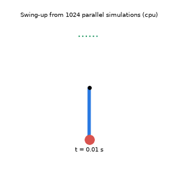
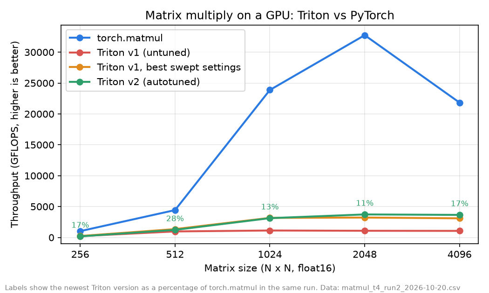

# GPU Robot Lab

[**Live explainer**](https://therealemmanueloppong.github.io/gpu-robot-lab/) | [](https://colab.research.google.com/github/therealemmanueloppong/gpu-robot-lab/blob/main/notebooks/colab_quickstart.ipynb)

[](https://colab.research.google.com/github/therealemmanueloppong/gpu-robot-lab/blob/main/notebooks/robot_sim_colab.ipynb) (robot simulation)

GPU kernels written from scratch and benchmarked against PyTorch, then used to speed up a simulated robot. Built to run on a free shared GPU, so it costs nothing.

Status: early but measured. The Triton matmul and softmax kernels are **correct** (checked against PyTorch on a Colab T4). The first matmul reached about 4% of `torch.matmul`. A sweep of 135 settings and a compiler check found that it was **spilling registers**, and tuned versions run about **3.4 times faster** (v2: 11 to 17% of PyTorch at large sizes). The remaining gap to PyTorch is open work. Stage 2 (a simulated robot planned with thousands of parallel simulations) is built and verified on a CPU; its GPU speed numbers have not been measured yet. Measurements are below.

See [docs/PLAN.md](docs/PLAN.md) for the stages, the rules for what can be claimed, and the risks.

## See it

- **[Interactive explainer (live page)](https://therealemmanueloppong.github.io/gpu-robot-lab/)**: animates how the tiled kernel loads tiles and why it reads about 64 times less memory than a naive multiply, and shows the measured results. The source is `docs/index.html`.
- **Results chart**: below, from real runs on a Colab T4.
- **Robot simulation (stage 2)**: a pendulum whose motor is too weak to lift it directly. Thousands of candidate motor plans are simulated at once (MuJoCo MJX), the best are kept, and the swing-up is replayed in a separate CPU simulator as a check. Preview below, run on a laptop CPU:

  

- **v2 kernel**: autotuning plus grouped launch order. `scripts/check_kernels.py` and `scripts/bench_matmul.py` now check and time v1, v2 and `torch.matmul` together, so one Colab run produces the comparison.
- **Tuning study and diagnosis**: `scripts/tune_matmul.py` sweeps tile sizes, warps and pipeline stages, and `scripts/inspect_kernel.py` prints register use and spills. Results below.

## What is in the repo

- `src/gpu_robot_lab/kernels/` a tiled matrix multiply (`matmul.py`, v1), an autotuned v2 with a cache-friendly launch order (`matmul_v2.py`), and a row-wise softmax, all in Triton
- `src/gpu_robot_lab/tiling.py` a CPU model of the kernel's tiling, edge handling and launch order, tested in CI, with the memory-traffic formula
- `src/gpu_robot_lab/bench.py` timing that works correctly for asynchronous GPU code, plus GFLOPS and speedup helpers
- `src/gpu_robot_lab/reference.py` and `checks.py` the CPU ground truth and error checking
- `scripts/check_kernels.py` checks every kernel against PyTorch
- `scripts/bench_matmul.py` times the Triton matmul against `torch.matmul` and writes a CSV
- `scripts/tune_matmul.py` and `scripts/plot_tuning.py` sweep launch settings and chart the best ones (GPU needed)
- `scripts/plot_results.py` draws a results chart from a CSV
- `src/gpu_robot_lab/sim.py` and `viz.py` the simulated pendulum, the parallel planner (cross-entropy method over MJX) and the GIF drawing (needs the `sim` and `plot` extras)
- `scripts/run_swingup.py` plans and replays a swing-up, `scripts/bench_sim.py` compares CPU and parallel simulation speed, `notebooks/robot_sim_colab.ipynb` runs both on a Colab GPU
- `docs/index.html` the interactive explainer
- `notebooks/colab_quickstart.ipynb` runs all of the above on a free Colab GPU

## Run the tests (no GPU needed)

```bash
pip install -e '.[dev]'
pytest -q
ruff check .
```

GPU tests are skipped automatically when no CUDA GPU is found.

## Run the kernels on a free GPU

1. Click the **Open in Colab** badge at the top of this page.
2. Choose Runtime, then Change runtime type, and pick a GPU.
3. Run the cells in order. Expect `ALL PASSED` from the correctness check, then a results table.

Kaggle notebooks also offer a free GPU and work the same way. Free-tier limits change over time.

## Results

All numbers are from a free Tesla T4 on Google Colab on 2026-10-20 (torch 2.11.0, triton 3.6.0, CUDA 13.0), in float16. Every kernel version was checked against PyTorch first and gave correct answers.

### 1. All versions compared (second run)



Command: `python scripts/bench_matmul.py` (median of 50 runs after 10 warm-up runs). Raw data: [results/matmul_t4_run2_2026-10-20.csv](results/matmul_t4_run2_2026-10-20.csv).

| Size | torch.matmul (GFLOPS) | v1 default | v1, best sweep settings | v2 autotuned | v2 vs torch |
|---|---|---|---|---|---|
| 256 | 1,023 | 215 | 232 | 173 | 17% |
| 512 | 4,427 | 975 | 1,353 | 1,226 | 28% |
| 1024 | 23,876 | 1,126 | 3,171 | 3,125 | 13% |
| 2048 | 32,751 | 1,081 | 3,222 | 3,728 | 11% |
| 4096 | 21,833 | 1,063 | 3,097 | 3,652 | 17% |

At 2048 and 4096, v2 is about 3.4 times faster than the first kernel and 15 to 18% faster than v1 with the best sweep settings. At small sizes v2 is not better. v2 changes several things at once (tile settings picked by the autotuner, and the grouped launch order), so these numbers do not show which one helped.

Run-to-run variation is large on a shared GPU: `torch.matmul` at 2048 measured 17,606 GFLOPS in the first run and 32,751 in this one. Compare versions within one run, and treat the percentages as rough.

### 2. Why the first kernel was slow

`python scripts/inspect_kernel.py` prints what the compiler did for each setting ([results/inspect_t4_2026-10-20.csv](results/inspect_t4_2026-10-20.csv)). Speeds are from the sweep below (3 pipeline stages, 2048 x 2048).

| Setting (tile MxNxK, warps) | Registers | Spills | GFLOPS |
|---|---|---|---|
| 64x64x32, 4 warps (v1 default) | 255 | 84 | 979 |
| 64x64x32, 2 warps | 64 | 972 | 90 |
| 64x64x32, 8 warps | 188 | 0 | 2,528 |
| 64x64x16, 8 warps | 118 | 0 | 2,807 |
| 64x64x16, 4 warps (best) | 200 | 0 | 3,035 |

The default kernel used 255 registers per thread, which is the maximum, and the compiler spilled 84 values to slow memory. The 2-warp setting spilled 972 and ran about 100 times slower. Settings with a K-tile of 16 needed fewer registers and spilled nothing. Settings that spill are slow and settings that do not are fast, which is strong evidence that spilling was the main cause. It is a pattern across a few settings, not a controlled experiment.

### 3. The tuning sweep

Command: `python scripts/tune_matmul.py --size 2048`. It tried 135 combinations of tile size, K-tile, warps and pipeline stages. All 135 compiled and gave correct answers. `torch.matmul` ran at about 18,500 GFLOPS in that run.

| Setting (tile MxNxK, warps, stages) | GFLOPS | vs torch |
|---|---|---|
| 64x64x32, 4 warps, 3 stages (v1 default) | 979 | 5% |
| 64x64x16, 4 warps, 4 stages (best) | 3,045 | 16% |
| 64x64x16, 4 warps, 2 stages | 3,036 | 16% |
| 64x64x16, 4 warps, 3 stages | 3,035 | 16% |
| 64x128x16, 8 warps, 4 stages | 2,892 | 16% |
| 64x128x16, 8 warps, 2 stages | 2,886 | 16% |

Pipeline stages hardly mattered (3,045, 3,036 and 3,035 GFLOPS). One possible reason is that the T4's generation of GPU lacks the hardware support those stages rely on. That is a hypothesis and has not been tested. Raw numbers for the rows above: [results/tuning_top5_t4_2048_2026-10-20.csv](results/tuning_top5_t4_2048_2026-10-20.csv). The full 135-row file is not in the repo yet.

### First run (v1 only)

Before tuning, v1 reached 4 to 34% of PyTorch depending on size ([results/matmul_t4_2026-10-20.csv](results/matmul_t4_2026-10-20.csv), [chart](results/matmul_t4_2026-10-20.png)).

### 4. Robot simulation (CPU preview only)

Run on a laptop CPU (no GPU), 2026-10-20, `python scripts/run_swingup.py --batch 1024 --iterations 15` ([results/cpu_preview/swingup.json](results/cpu_preview/swingup.json)): the planner found a swing-up in 2.8 seconds. A separate replay in plain MuJoCo ended with the pole tip 0.498 m above the hinge, where the top is 0.5 m. Tests also check that the MJX simulator and plain MuJoCo agree to within 0.0001 radians over 200 steps, and that the motor alone cannot lift the pole.

This is a CPU run. It shows the method works. It does not show GPU speed-ups, which need the Colab notebook (`notebooks/robot_sim_colab.ipynb`) to be run.

### Not yet measured

- Which part of v2 helps: the tile settings, or the grouped launch order. That needs one change at a time.
- How much the results vary: each number above is from one run.
- Why `torch.matmul` is still about 6 to 9 times faster at large sizes.
- The GPU speed of the robot simulation (batch sizes up to 16,384 against one CPU thread), and the swing-up planned on a GPU. Both are in the stage 2 notebook and have not been run.
- A learned control policy for the robot. Stage 2 uses planning, not reinforcement learning.
