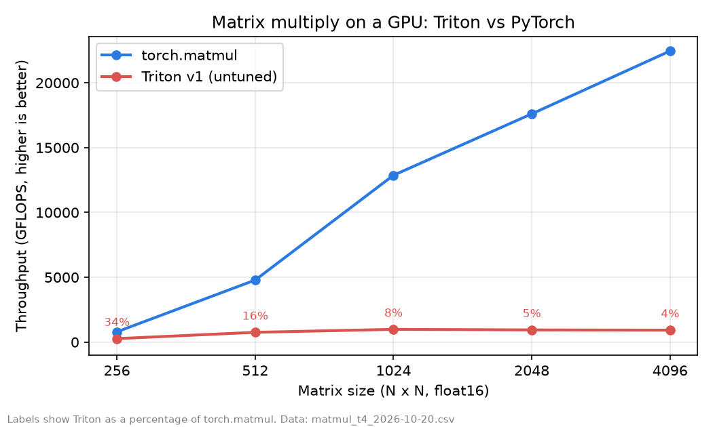

# GPU Robot Lab

[**Live explainer**](https://therealemmanueloppong.github.io/gpu-robot-lab/) | [](https://colab.research.google.com/github/therealemmanueloppong/gpu-robot-lab/blob/main/notebooks/colab_quickstart.ipynb)

GPU kernels written from scratch and benchmarked against PyTorch, then used to speed up a simulated robot. Built to run on a free shared GPU, so it costs nothing.

Status: early. The Triton matmul and softmax kernels are **correct** (checked against PyTorch on a Colab T4) but the first matmul is **far slower than `torch.matmul`**. Tuning it is stage 1, step 3. Measurements are below.

See [docs/PLAN.md](docs/PLAN.md) for the stages, the rules for what can be claimed, and the risks.

## See it

- **[Interactive explainer (live page)](https://therealemmanueloppong.github.io/gpu-robot-lab/)**: animates how the tiled kernel loads tiles and why it reads about 64 times less memory than a naive multiply, and shows the measured results. The source is `docs/index.html`.
- **Results chart**: below, from real runs on a Colab T4.
- **v2 kernel**: autotuning plus grouped launch order. `scripts/check_kernels.py` and `scripts/bench_matmul.py` now check and time v1, v2 and `torch.matmul` together, so one Colab run produces the comparison.
- **Tuning study**: `scripts/tune_matmul.py` sweeps tile sizes, warps and pipeline stages. Its chart goes here once it has been run.

## What is in the repo

- `src/gpu_robot_lab/kernels/` a tiled matrix multiply (`matmul.py`, v1), an autotuned v2 with a cache-friendly launch order (`matmul_v2.py`, **written but not yet run on a GPU**), and a row-wise softmax, all in Triton
- `src/gpu_robot_lab/tiling.py` a CPU model of the kernel's tiling, edge handling and launch order, tested in CI, with the memory-traffic formula
- `src/gpu_robot_lab/bench.py` timing that works correctly for asynchronous GPU code, plus GFLOPS and speedup helpers
- `src/gpu_robot_lab/reference.py` and `checks.py` the CPU ground truth and error checking
- `scripts/check_kernels.py` checks every kernel against PyTorch
- `scripts/bench_matmul.py` times the Triton matmul against `torch.matmul` and writes a CSV
- `scripts/tune_matmul.py` and `scripts/plot_tuning.py` sweep launch settings and chart the best ones (GPU needed, not yet run)
- `scripts/plot_results.py` draws a results chart from a CSV
- `docs/index.html` the interactive explainer
- `notebooks/colab_quickstart.ipynb` runs all of the above on a free Colab GPU

## Run the tests (no GPU needed)

```bash
pip install -e '.[dev]'
pytest -q
ruff check .
```

GPU tests are skipped automatically when no CUDA GPU is found.

## Run the kernels on a free GPU

1. Click the **Open in Colab** badge at the top of this page.
2. Choose Runtime, then Change runtime type, and pick a GPU.
3. Run the cells in order. Expect `ALL PASSED` from the correctness check, then a results table.

Kaggle notebooks also offer a free GPU and work the same way. Free-tier limits change over time.

## Results

### Matrix multiply, first version (untuned), float16



Measured on a Tesla T4 on Google Colab, 2026-10-20, with `python scripts/bench_matmul.py` (median of 50 runs after 10 warm-up runs). The package versions were not printed on this run, so the script now prints them. Raw data: [results/matmul_t4_2026-10-20.csv](results/matmul_t4_2026-10-20.csv).

| Size | torch.matmul (GFLOPS) | Triton v1 (GFLOPS) | Triton speed vs torch |
|---|---|---|---|
| 256 | 790 | 267 | 0.34x |
| 512 | 4,784 | 753 | 0.16x |
| 1024 | 12,870 | 983 | 0.08x |
| 2048 | 17,606 | 939 | 0.05x |
| 4096 | 22,456 | 920 | 0.04x |

Correctness: `scripts/check_kernels.py` passed for all 4 matmul shapes (largest error 0.0625 in float16) and all 3 softmax shapes.

What this says: the kernel gives the right answers, but at large sizes it reaches only about 4% of PyTorch's speed, so its work is not using the GPU well yet. The first version uses one fixed tile size and the default launch settings. Next: try larger tiles, more warps and pipeline stages, measure each change on its own, and record what helps.
